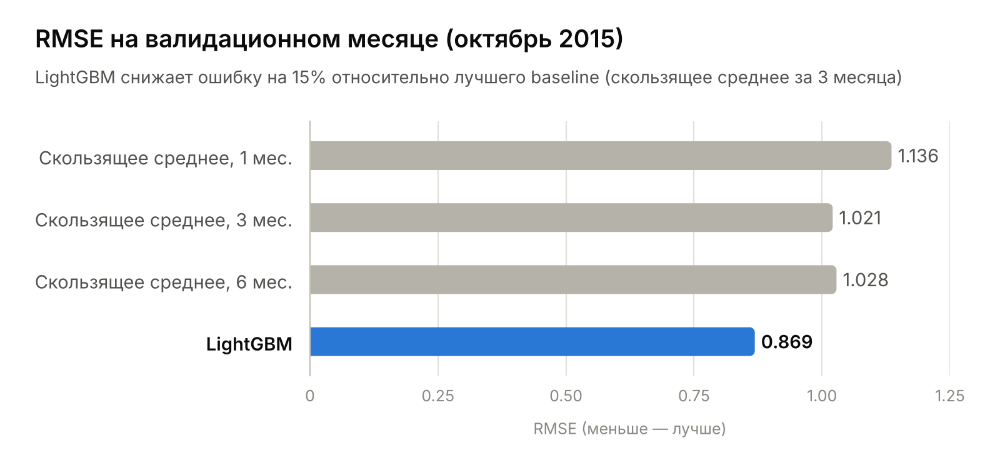

# Прогноз продаж: Kaggle Predict Future Sales

Прогноз месячных продаж по парам магазин–товар на ноябрь 2015 (Kaggle, 1С): LightGBM снижает RMSE на валидации до **0.869** — на **15%** ниже лучшего baseline.




*RMSE трёх скользящих средних и LightGBM на октябре 2015; значения из `metrics.json`.*

## Ключевые результаты

- **RMSE 0.869 у LightGBM** на валидационном месяце (октябрь 2015) против 1.021 у лучшего baseline (скользящее среднее за 3 месяца) — ошибка ниже на **15%**.
- **Сетка магазин × товар с нулями** для пар без продаж — как в тесте, где большинство пар нулевые.
- **Весь пайплайн — один скрипт** `forecast.py`: сетка, признаки, baseline, LightGBM и два файла для отправки на Kaggle.

## Содержание

- [Задача](#задача)
- [Данные](#данные)
- [Подход](#подход)
- [Результаты](#результаты)
- [Ограничения](#ограничения)
- [Структура проекта](#структура-проекта)
- [Запуск](#запуск)

## Задача

Соревнование [Predict Future Sales](https://www.kaggle.com/competitions/competitive-data-science-predict-future-sales) (1С).

- **Вход:** ежедневные продажи за январь 2013 – октябрь 2015.
- **Что предсказать:** сколько штук каждого товара продаст каждый магазин в ноябре 2015.
- **Метрика:** RMSE по месячным продажам, обрезанным в диапазон 0–20.

## Данные

Скрипт ожидает в папке `data` файлы соревнования: `sales_train.csv`, `test.csv`, `items.csv`, `item_categories.csv`, `shops.csv`.

Перед агрегацией данные очищаются:

- отброшены выбросы по цене и количеству — строки с ценой ≤ 0 или ≥ 100 000, а также строки с дневным количеством ≤ −1 000 или ≥ 1 000;
- три магазина-дубликата (одинаковые названия в `shops.csv`, разные id: 0→57, 1→58, 11→10) сведены к тем id, которые есть в тесте.

## Подход

### Сетка магазин × товар

Для каждого месяца строится декартово произведение «все магазины, работавшие в этом месяце × все товары, проданные в этом месяце», и пары без продаж получают ноль. Без этого модель видит только ненулевые продажи и систематически завышает прогноз, а в тесте большинство пар как раз нулевые.

### Baseline

Скользящее среднее продаж пары магазин–товар за последние 1, 3 и 6 месяцев (месяцы без продаж считаются нулями).

### Признаки LightGBM

| Группа | Признаки |
|---|---|
| Лаги продаж пары магазин–товар | за 1, 2, 3, 6 и 12 месяцев |
| Лаги средних продаж | по товару (1–3 месяца), магазину, категории и паре магазин + категория (1 месяц) |
| Скользящие статистики | среднее и стандартное отклонение за 3 месяца, тренд |
| Возраст | товара и пары магазин–товар — месяцев с первой продажи |
| Статические | средняя цена товара, категория и её тип, месяц года |

Первые 12 месяцев уходят на заполнение лага 12 и в обучение не попадают.

### Валидация и финальная модель

Модель учится на месяцах до сентября 2015 включительно и проверяется на октябре 2015 (месяц 33) — прогноз на следующий месяц, как в настоящем тесте.

Финальная модель переобучается на всех месяцах до октября 2015 включительно с числом итераций `best_iteration × 1.05` и предсказывает ноябрь. Прогноз, как и целевая переменная, обрезается в 0–20.

<details>
<summary><b>Параметры LightGBM</b></summary>

| Параметр | Значение |
|---|---|
| `objective` / `metric` | `regression` / `rmse` |
| `learning_rate` | 0.05 |
| `num_leaves` | 255 |
| `min_data_in_leaf` | 100 |
| `feature_fraction` | 0.75 |
| `bagging_fraction` / `bagging_freq` | 0.75 / 1 |
| `lambda_l2` | 1.0 |
| Максимум итераций / ранняя остановка | 1 000 / 50 |
| Категориальные признаки | `shop_id`, `item_category_id`, `cat_type`, `month` |

</details>

## Результаты

| Модель | RMSE на октябре 2015 |
|---|---:|
| Скользящее среднее, 1 месяц | 1.136 |
| Скользящее среднее, 3 месяца | 1.021 |
| Скользящее среднее, 6 месяцев | 1.028 |
| **LightGBM** | **0.869** |

Ранняя остановка выбрала 82 итерации. Числа взяты из [`metrics.json`](metrics.json).

## Ограничения

- **Валидация на одном месяце.** Модели сравниваются только на октябре 2015; оценка не усреднена по нескольким месяцам.
- **Публичный счёт на Kaggle не приводится.** Результат `submission.csv` на лидерборде соревнования в репозитории не указан.

## Структура проекта

```text
predict-future-sales/
├── forecast.py              # весь пайплайн: сетка, признаки, baseline, LightGBM, сабмиты
├── metrics.json             # метрики последнего прогона
├── requirements.txt         # зависимости
├── .gitignore               # исключает data/, output/ и служебные файлы Python, IDE и ОС
└── figures/
    └── rmse_comparison.png  # сравнение RMSE моделей на валидации
```

Папка `data/` появляется после шага скачивания данных (`kaggle competitions download` в разделе [«Запуск»](#запуск)), а `output/` создаёт `forecast.py` (`os.makedirs`). Обе папки перечислены в `.gitignore` и в репозиторий не попадают.

## Запуск

```bash
pip install -r requirements.txt
kaggle competitions download -c competitive-data-science-predict-future-sales -p data
unzip data/competitive-data-science-predict-future-sales.zip -d data
python forecast.py --data data --out output
```

Для скачивания нужен [Kaggle API token](https://www.kaggle.com/docs/api) и принятые правила соревнования.

Результат в `output/`:

| Файл | Что внутри |
|---|---|
| `submission.csv` | прогноз LightGBM для отправки на Kaggle |
| `submission_baseline.csv` | прогноз скользящего среднего за 3 месяца |
| `metrics.json` | RMSE всех моделей на валидационном месяце |
| `feature_importance.csv` | важность признаков LightGBM (gain) |
